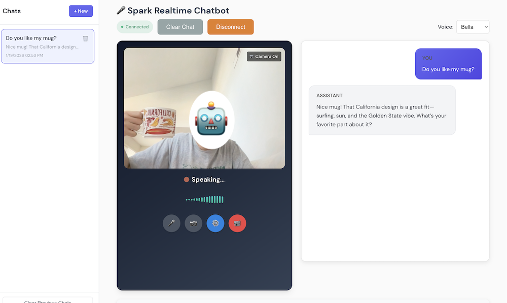

# spark-realtime

A real-time voice and vision AI assistant running locally on NVIDIA DGX Spark — streaming speech recognition (ASR), vision-language models (VLM/LLM), face recognition, and text-to-speech (TTS), all on a single Grace Blackwell GB10.

> **Fork & Coexistence Note**: This repository (`sammyjason39/spark-realtime`) is a fork of [`kedarpotdar-nv/spark-realtime-chatbot`](https://github.com/kedarpotdar-nv/spark-realtime-chatbot). To run alongside the original app on the same DGX Spark without port collisions, **this fork runs on port `9443` by default** (+1000 offset from the original's `8443`), offsets its own optional standalone servers by +1000, and shares the GPU-heavy `llama-server` instances on ports `8080` and `8005` by default:
>
> | Service | Fork Default (`spark-realtime`) | Original Default (`spark-realtime-chatbot`) | Env Var / Flag | Coexistence Behavior |
> |---------|---------------------------------|---------------------------------------------|----------------|----------------------|
> | **Web App (HTTPS + `/ws/voice` WSS)** | `9443` | `8443` | `PORT` / `--port` | Offset (+1000) — runs concurrently |
> | **External ASR API Server** (`ASR_MODE=api`) | `9000` | `8000` | `ASR_API_URL` | Offset (+1000) — optional; `--local-asr` runs in-process |
> | **Standalone TTS HTTP Server** (`tts_server.py`) | `9002` | `8002` | `TTS_PORT` | Offset (+1000) — optional standalone wrapper |
> | **LLM / VLM `llama-server` (Qwen3-VL)** | `8080` | `8080` | `LLM_SERVER_URL`, `VLM_SERVER_URL` | Shared by default (~20 GB VRAM); set to `:9080` for a separate instance |
> | **Reasoning `llama-server` (Nemotron 3 Nano)** | `8005` | `8005` | `NEMOTRON_SERVER_URL` | Shared by default (~18 GB VRAM); set to `:9005` for a separate instance |



**Highlights:**
- **Ultra-low latency**: ~320ms voice calls, ~850ms video calls (end-to-end)
- **Runs entirely on-device**: No cloud APIs required; all frontend dependencies (`marked`, `onnxruntime-web`, `vad-web`, `Inter`, `JetBrains Mono`, and Lucide SVG icons) are vendored locally in `static/`
- **Vision + Voice**: Video calls with real-time scene understanding (Qwen3-VL)
- **Local media (ComfyUI)**: On-device image (`generate_image` / `edit_image`, FLUX.2 Klein) and music (`generate_music`, ACE-Step 1.5) via a local ComfyUI API on the Spark, with workspace artifacts and REST `POST /api/media/generate` for Hermes
- **Hermes Agent Integration**: Non-blocking background task delegation (`delegate_task`) to [Nous Research Hermes Agent](https://github.com/NousResearch/hermes-agent) with live step/tool progress and shared workspace artifact previews
- **Face Recognition**: Enroll and identify users on the fly (DeepFace)
- **GB10-optimized**: ASR, LLM, TTS, and vision running locally on DGX Spark
- **Trusted LAN HTTPS**: Built-in `mkcert` setup for warning-free mic/camera access from macOS and iOS devices on your LAN (served on port `9443`)

**Performance on DGX Spark:**
| Component | Latency | RTF |
|-----------|---------|-----|
| ASR (faster-whisper) | ~200ms | 0.07x |
| LLM (Qwen3-VL text) | ~65ms TTFT | — |
| VLM (Qwen3-VL vision) | ~600ms | — |
| TTS (Kokoro) | ~50ms | 0.03x |

*End-to-end: ~320ms voice calls, ~850ms video calls*

---

## Instructions for AI Agents

If you are an autonomous coding agent (Claude Code, Cursor, OpenCode, etc.) setting up and running this repository on a fresh NVIDIA DGX Spark, execute this ordered checklist end to end:

```bash
# 1. Verify GPU, CUDA, and Docker with NVIDIA runtime
nvidia-smi
nvcc --version
docker info | grep -i runtime

# 2. Install host dependencies & mkcert (ARM64)
sudo apt-get update && sudo apt-get install -y \
    git curl wget build-essential cmake ffmpeg espeak-ng libsndfile1 libnss3-tools openssl
if ! command -v mkcert >/dev/null 2>&1; then
    curl -fsSL "https://dl.filippo.io/mkcert/latest?for=linux/arm64" -o /tmp/mkcert
    chmod +x /tmp/mkcert
    sudo mv /tmp/mkcert /usr/local/bin/mkcert
fi

# 3. Clone this repository
cd ~
git clone https://github.com/sammyjason39/spark-realtime.git
cd ~/spark-realtime

# 4. Generate locally-trusted LAN HTTPS certificates (cert.pem & key.pem)
./scripts/setup-mkcert-https.sh

# 5. Build llama.cpp with CUDA for Grace Blackwell GB10 (sm_121)
if [ ! -x ~/llama.cpp/build/bin/llama-server ]; then
    git clone https://github.com/ggerganov/llama.cpp.git ~/llama.cpp
    cmake -S ~/llama.cpp -B ~/llama.cpp/build \
        -DGGML_CUDA=ON \
        -DCMAKE_CUDA_ARCHITECTURES=121 \
        -DCMAKE_BUILD_TYPE=Release
    cmake --build ~/llama.cpp/build --config Release -j"$(nproc)" --target llama-server
fi

# 6. Download GGUF models (~20 GB for Qwen3-VL + mmproj; ~18 GB optional for Nemotron)
mkdir -p ~/models
wget -c -O ~/models/Qwen3VL-30B-A3B-Instruct-Q4_K_M.gguf \
    https://huggingface.co/Qwen/Qwen3-VL-30B-A3B-Instruct-GGUF/resolve/main/Qwen3VL-30B-A3B-Instruct-Q4_K_M.gguf
wget -c -O ~/models/mmproj-Qwen3VL-30B-A3B-Instruct-Q8_0.gguf \
    https://huggingface.co/Qwen/Qwen3-VL-30B-A3B-Instruct-GGUF/resolve/main/mmproj-Qwen3VL-30B-A3B-Instruct-Q8_0.gguf

# (Optional) Download Nemotron-3-Nano reasoning model:
# wget -c -O ~/models/Nemotron-3-Nano-30B-A3B-Q4_K_M.gguf \
#     https://huggingface.co/unsloth/Nemotron-3-Nano-30B-A3B-GGUF/resolve/main/Nemotron-3-Nano-30B-A3B-Q4_K_M.gguf

# 7. Start llama-server in the background for Qwen3-VL on port 8080 (if not already running)
if ! curl -fsS http://localhost:8080/health >/dev/null 2>&1; then
    nohup ~/llama.cpp/build/bin/llama-server \
        -m ~/models/Qwen3VL-30B-A3B-Instruct-Q4_K_M.gguf \
        --mmproj ~/models/mmproj-Qwen3VL-30B-A3B-Instruct-Q8_0.gguf \
        --host 0.0.0.0 --port 8080 \
        -ngl 99 -c 8192 --threads 8 --threads-http 8 -fa on --cache-reuse 256 \
        > ~/llama-qwen3vl.log 2>&1 &
fi

# Wait until llama-server reports healthy
until curl -fsS http://localhost:8080/health >/dev/null 2>&1; do sleep 2; done

# 8. (Optional) Install and start Hermes Agent Gateway on DGX Spark ARM64 (port 8642)
if [ ! -d ~/hermes-agent ]; then
    git clone https://github.com/NousResearch/hermes-agent.git ~/hermes-agent
    python3 -m venv ~/hermes-agent/.venv
    ~/hermes-agent/.venv/bin/pip install --upgrade pip
    ~/hermes-agent/.venv/bin/pip install -e ~/hermes-agent
fi
nohup env \
    OPENAI_BASE_URL="http://127.0.0.1:8080/v1" \
    OPENAI_API_KEY="local-spark" \
    HERMES_WORKSPACE="$(pwd)/workspace" \
    ~/hermes-agent/.venv/bin/hermes gateway --host 127.0.0.1 --port 8642 \
    > ~/hermes-gateway.log 2>&1 &

# 9. Build and start the spark-realtime Docker container (port 9443)
cd ~/spark-realtime
mkdir -p workspace
docker build -t spark-realtime .
docker run -d --name spark-realtime --gpus all --net host --init \
    -v ~/.cache/huggingface:/root/.cache/huggingface \
    -v "$(pwd)/workspace:/app/workspace" \
    -v "$(pwd)/cert.pem:/app/cert.pem:ro" \
    -v "$(pwd)/key.pem:/app/key.pem:ro" \
    -e HERMES_URL="http://127.0.0.1:8642" \
    spark-realtime

# 10. Verify the server and Hermes bridge are healthy (allow ~30-60s on first start for ASR/TTS warmup)
until curl -k -fsS https://localhost:9443/health; do sleep 2; done
curl -k -fsS https://localhost:9443/api/agents/status
```

---

## Prerequisites

- **Hardware & OS**: NVIDIA DGX Spark (ARM64 `aarch64`, Grace Blackwell GB10 GPU `sm_121`) running DGX OS (Ubuntu 24.04 LTS).
- **CUDA**: NVIDIA Driver and CUDA 13.0+ installed on the host (`nvidia-smi` and `nvcc --version`).
- **Docker (for Docker path)**: Docker Engine with [NVIDIA Container Toolkit](https://docs.nvidia.com/datacenter/cloud-native/container-toolkit/latest/install-guide.html) configured so `--gpus all` works.
- **Python & System Libraries (for non-Docker path)**:
  - Python 3.10+ (Python 3.12 comes standard on Ubuntu 24.04)
  - `ffmpeg`, `espeak-ng`, `libsndfile1`, `openssl`, `cmake`, `build-essential`

---

## Step-by-Step Installation & Setup

### 1. Clone the Repository

```bash
git clone https://github.com/sammyjason39/spark-realtime.git
cd spark-realtime
```

### 2. Build `llama.cpp` with CUDA

Build `llama.cpp` from source on the DGX Spark host with CUDA enabled for the GB10 architecture (`compute_121` / `sm_121`):

```bash
git clone https://github.com/ggerganov/llama.cpp.git ~/llama.cpp
cmake -S ~/llama.cpp -B ~/llama.cpp/build \
    -DGGML_CUDA=ON \
    -DCMAKE_CUDA_ARCHITECTURES=121 \
    -DCMAKE_BUILD_TYPE=Release
cmake --build ~/llama.cpp/build --config Release -j"$(nproc)" --target llama-server
```

### 3. Download Models

Download the GGUF model files from HuggingFace into `~/models`:

```bash
mkdir -p ~/models

# 1. Qwen3-VL-30B-A3B-Instruct (Primary LLM + Vision Language Model, required)
#    Repo: https://huggingface.co/Qwen/Qwen3-VL-30B-A3B-Instruct-GGUF
wget -c -O ~/models/Qwen3VL-30B-A3B-Instruct-Q4_K_M.gguf \
    https://huggingface.co/Qwen/Qwen3-VL-30B-A3B-Instruct-GGUF/resolve/main/Qwen3VL-30B-A3B-Instruct-Q4_K_M.gguf

wget -c -O ~/models/mmproj-Qwen3VL-30B-A3B-Instruct-Q8_0.gguf \
    https://huggingface.co/Qwen/Qwen3-VL-30B-A3B-Instruct-GGUF/resolve/main/mmproj-Qwen3VL-30B-A3B-Instruct-Q8_0.gguf

# 2. Nemotron-3-Nano-30B-A3B (Reasoning Assistant Agent, optional)
#    Repo: https://huggingface.co/unsloth/Nemotron-3-Nano-30B-A3B-GGUF
wget -c -O ~/models/Nemotron-3-Nano-30B-A3B-Q4_K_M.gguf \
    https://huggingface.co/unsloth/Nemotron-3-Nano-30B-A3B-GGUF/resolve/main/Nemotron-3-Nano-30B-A3B-Q4_K_M.gguf
```

> **Note on ASR & TTS Models**:
> - **ASR (`faster-whisper`)**: Automatically downloads from HuggingFace on first startup (`Systran/faster-distil-whisper-large-v3` in Docker or `Systran/faster-whisper-small.en` by default in `launch-https.sh`).
> - **TTS (`Kokoro`)**: Automatically downloads voice tensors (`hexgrad/Kokoro-82M`) into the HuggingFace cache on first startup.

### 4. Start the LLM Servers

Start `llama-server` on the host in separate terminals (or via `tmux` / `nohup`). If you are already running `llama-server` on ports `8080` / `8005` for `spark-realtime-chatbot`, you can share those running instances directly without launching duplicates.

**Terminal 1 — Qwen3-VL (Main Chat & Vision Model on port `8080`, required):**
```bash
~/llama.cpp/build/bin/llama-server \
    -m ~/models/Qwen3VL-30B-A3B-Instruct-Q4_K_M.gguf \
    --mmproj ~/models/mmproj-Qwen3VL-30B-A3B-Instruct-Q8_0.gguf \
    --host 0.0.0.0 --port 8080 \
    -ngl 99 -c 8192 --threads 8 --threads-http 8 -fa on --cache-reuse 256
```

**Terminal 2 — Nemotron 3 Nano (Reasoning Model on port `8005`, optional):**
```bash
~/llama.cpp/build/bin/llama-server \
    -m ~/models/Nemotron-3-Nano-30B-A3B-Q4_K_M.gguf \
    --host 0.0.0.0 --port 8005 \
    -ngl 99 -c 32768 --threads 8 --threads-http 8 -fa on --cache-reuse 256
```

---

## Local media generation (ComfyUI)

Spark can generate **images** and **music** on the same machine via [ComfyUI](https://github.com/comfyanonymous/ComfyUI) (default API `http://127.0.0.1:8188`). This path is preferred over Hermes for simple local generation when ComfyUI is running.

### Models & templates

Shipped API-format workflows (derived from [Comfy-Org/workflow_templates](https://github.com/Comfy-Org/workflow_templates)) live in `workflows/comfyui/`:

| Workflow file | Upstream template | Models |
|---------------|-------------------|--------|
| `flux2_klein_t2i.json` | `image_flux2_klein_text_to_image` | [FLUX.2 Klein 4B](https://huggingface.co/Comfy-Org/flux2-klein) (`flux-2-klein-4b.safetensors`, `qwen_3_4b.safetensors`, `flux2-vae.safetensors`) |
| `flux2_klein_edit.json` | `image_flux2_klein_image_edit_4b_distilled` | Klein edit (`flux-2-klein-4b-fp8.safetensors`, same CLIP/VAE) |
| `ace_step_1_5_music.json` | `audio_ace_step1_5_xl_turbo` | [ACE-Step 1.5](https://huggingface.co/Comfy-Org/ace_step_1.5) (`acestep_v1.5_xl_turbo_bf16.safetensors`, `ace_1.5_vae.safetensors`, Qwen ACE CLIP pair) |

Place weights under your ComfyUI install (`ComfyUI/models/diffusion_models`, `text_encoders`, `vae`, etc.) per each template’s model card. If node names differ on your build, export **API format** from ComfyUI and override paths with env vars below.

### Launch ComfyUI on the Spark

```bash
cd ~/ComfyUI
python main.py --listen 127.0.0.1 --port 8188
```

Install custom nodes / ACE-Step & FLUX.2 Klein support as required by your ComfyUI version (see Comfy-Org docs and the template README links).

### Environment variables

| Variable | Default | Purpose |
|----------|---------|---------|
| `COMFYUI_URL` | `http://127.0.0.1:8188` | ComfyUI HTTP API base |
| `COMFYUI_ENABLED` | auto (`true` unless `false`) | Master switch; reachability checked at runtime |
| `COMFYUI_TIMEOUT` | `600` | Job timeout (seconds) |
| `COMFYUI_DEFAULT_WIDTH` / `HEIGHT` | `1024` | Image defaults |
| `COMFYUI_DEFAULT_STEPS` | `4` | Klein distilled step default |
| `COMFYUI_FLUX_T2I_WORKFLOW` | `workflows/comfyui/flux2_klein_t2i.json` | Override T2I API workflow |
| `COMFYUI_FLUX_EDIT_WORKFLOW` | `workflows/comfyui/flux2_klein_edit.json` | Override edit workflow |
| `COMFYUI_ACE_WORKFLOW` | `workflows/comfyui/ace_step_1_5_music.json` | Override music workflow |
| `COMFYUI_FLUX_UNET` / `FLUX_EDIT_UNET` / `FLUX_CLIP` / `FLUX_VAE` | see `config.py` | Model filename overrides |
| `COMFYUI_ACE_UNET` / `ACE_VAE` | ACE turbo + VAE defaults | Music model overrides |

### Node title convention

Spark injects prompts, seeds, sizes, and durations by `_meta.title` on API workflows (not hardcoded node IDs). See `workflows/comfyui/README.md` for titles such as `PROMPT`, `SEED`, `WIDTH`, `INPUT_IMAGE`, `TAGS`, `DURATION`.

### Voice tools

Enable in Settings → **generate_image**, **edit_image**, **generate_music**. Outputs land in `workspace/media/` and appear in the Hermes panel **Artifacts** tab (image preview + audio player). Progress events show under **Activity**.

### REST: `POST /api/media/generate` (Hermes / HTTP)

Hermes or other agents can call Spark directly (same host):

```bash
# Text-to-image
curl -sk -X POST https://127.0.0.1:9443/api/media/generate \
  -H 'Content-Type: application/json' \
  -d '{"kind":"image","prompt":"A vaporwave fox logo, flat vector","width":1024,"height":1024}'

# Image edit (workspace-relative source)
curl -sk -X POST https://127.0.0.1:9443/api/media/generate \
  -H 'Content-Type: application/json' \
  -d '{"kind":"edit","prompt":"Make the sky sunset orange","source":"media/my_photo.png"}'

# Music (ACE-Step tags + optional lyrics)
curl -sk -X POST https://127.0.0.1:9443/api/media/generate \
  -H 'Content-Type: application/json' \
  -d '{"kind":"music","tags":"Chillhop, 85 BPM, warm keys","lyrics":"","duration_seconds":45}'
```

Register as a Hermes tool with HTTP POST to `https://<spark-host>:9443/api/media/generate`, or call from skills via `curl`/HTTP client. Responses include `path` (workspace-relative) on success.

> **Note**: Bundled ACE/music workflows are best-effort API exports from official UI templates. If ComfyUI rejects a prompt, replace the JSON with your own **Save (API Format)** export and point `COMFYUI_*_WORKFLOW` at it.

---

## Hermes Agent Setup on DGX Spark (ARM64)

`spark-realtime` includes an asynchronous background bridge (`agents/hermes.py`) to [Nous Research Hermes Agent](https://github.com/NousResearch/hermes-agent). When the `delegate_task` tool is enabled, Spark immediately acknowledges coding, app-building, or research requests over voice while Hermes executes in the background, streaming tool invocations, reasoning steps, and generated workspace artifacts to the right-side **Hermes Agent** panel.

> **Graceful Degradation**: If `HERMES_URL` is not set and `hermes` is not installed on `PATH`, the server starts cleanly with `configured: false` and `transport: unconfigured`, disabling `delegate_task` automatically while keeping all voice, vision, and local assistant tools active.

### 1. Install Hermes Agent on DGX Spark (`aarch64`)

```bash
git clone https://github.com/NousResearch/hermes-agent.git ~/hermes-agent
cd ~/hermes-agent
python3 -m venv .venv
source .venv/bin/activate
pip install --upgrade pip setuptools wheel
pip install -e .
```

### 2. Run Hermes Alongside `spark-realtime`

Point Hermes at your local `llama-server` (`http://127.0.0.1:8080/v1`) or an upstream OpenAI-compatible provider, sharing the `workspace/` directory with `spark-realtime`:

```bash
# Terminal 3 — Hermes Gateway API Server on port 8642
source ~/hermes-agent/.venv/bin/activate
export OPENAI_BASE_URL="http://127.0.0.1:8080/v1"
export OPENAI_API_KEY="local-spark"
export HERMES_WORKSPACE="$HOME/spark-realtime/workspace"
export API_SERVER_ENABLED=true
export API_SERVER_KEY="your-local-gateway-secret"

hermes gateway --host 127.0.0.1 --port 8642
```

The gateway HTTP API listens on `127.0.0.1:8642`, requires `API_SERVER_ENABLED=true`, and expects Bearer auth via `API_SERVER_KEY` (set the same value as `HERMES_API_KEY` in spark-realtime).

Then start `spark-realtime` with `HERMES_URL` configured:

```bash
export HERMES_URL="http://127.0.0.1:8642"
./launch-https.sh --local-asr --tts-overlap
```

### 3. Supported Hermes Transport Modes

`HermesAgentBridge` automatically probes and selects the fastest available transport:
1. **`gateway_runs`**: Hermes Gateway `/v1/runs` + `/v1/runs/{id}/events` SSE stream + `/v1/runs/{id}/stop` cancellation.
2. **`gateway_chat`**: Hermes Gateway `/v1/chat/completions` streaming SSE (supporting `hermes.tool.progress` events and reasoning deltas).
3. **`cli`**: Subprocess fallback via `hermes chat -q ...` when the `hermes` CLI binary is on `PATH` (`HERMES_CLI_PATH`).
4. **`local_openai`**: Built-in local agentic execution loop against `HERMES_UPSTREAM_URL` (defaults to `LLM_SERVER_URL` on port `8080`) when `HERMES_ENABLED=true` is set without a separate gateway daemon.

### Two-layer memory: local Qwen realtime + Hermes brain

Spark keeps a **fast local path** (Qwen via `llama-server` on the voice/video WebSocket) and a **background Hermes path** (`agents/hermes.py`) for long-running work:

- **Realtime (local)**: ASR → Qwen3-VL → TTS on `/ws/voice` (never blocked by Hermes).
- **Background (Hermes)**: `delegate_task` → Hermes Gateway `/v1/runs` or `/v1/chat/completions` with streaming tool progress.

**Persistent Hermes sessions**: The bridge stores a stable `X-Hermes-Session-Key` (long-term memory scope) and `X-Hermes-Session-Id` (transcript identity) per client identity in `workspace/.hermes_sessions.json` (override with `HERMES_SESSION_STORE`). Sessions are created via `POST /api/sessions` when the gateway supports it; both headers are sent on every gateway call.

**Memory injection**: On voice session connect (and after a delegated task completes), spark-realtime asynchronously asks Hermes—via a short non-streaming `/v1/chat/completions` on the persistent session—for a ≤150-word summary of user context and recent task results. The cached text is appended to the **local** model system prompt under a `## Long-term memory (from Hermes)` section. If Hermes is unreachable, the voice loop uses the last cache or proceeds without memory (`HERMES_MEMORY_TTL`, default 10 minutes).

**Camera on delegate**: During an active video call, `delegate_task` can attach the latest camera frame to Hermes using multimodal `/v1/chat/completions` (`image_url` data URI). Control with the `include_camera` tool parameter (default `true` when video is active).

---

## HTTPS Setup

Browsers require a secure context (`https://` or `localhost`) to allow microphone and camera access (`navigator.mediaDevices.getUserMedia`). When opening the app from a Mac, iPhone, or iPad over your LAN, an untrusted certificate triggers browser security warnings and can block `wss://` WebSocket connections or media streams.

Two HTTPS modes are supported:

### Mode 1: `mkcert` — Trusted Local CA on LAN (Primary, Recommended)

[`mkcert`](https://github.com/FiloSottile/mkcert) creates a local Certificate Authority (CA) on your Spark and signs a TLS certificate covering `localhost`, `127.0.0.1`, `<hostname>`, `<hostname>.local`, and the Spark's LAN IPv4 address. Once you trust its `rootCA.pem` on your Mac and iPhone/iPad, `https://<spark-hostname>.local:9443` and `https://<spark-lan-ip>:9443` open with a green lock and **zero browser warnings**.

#### 1. Install `mkcert` on the DGX Spark (ARM64)

```bash
sudo apt-get update && sudo apt-get install -y libnss3-tools
curl -JLO "https://dl.filippo.io/mkcert/latest?for=linux/arm64"
chmod +x mkcert-v*-linux-arm64
sudo mv mkcert-v*-linux-arm64 /usr/local/bin/mkcert
```

#### 2. Generate the Certificate

Run the helper script from the repository root:

```bash
./scripts/setup-mkcert-https.sh
```

This installs the local CA into the Spark's system trust store and generates `cert.pem` and `key.pem` in the repository root for:
- `localhost`, `127.0.0.1`, `::1`
- `<hostname>` and `<hostname>.local`
- All detected LAN IPv4 addresses on the Spark
- Any additional hostnames or IPs passed as arguments (e.g., `./scripts/setup-mkcert-https.sh 192.168.1.50 my-spark.lan`)

#### 3. Trust the Root CA on macOS and iOS

Find the root CA path on the Spark with `mkcert -CAROOT` (default: `~/.local/share/mkcert/rootCA.pem`). Copy **only** `rootCA.pem` to your client devices (never share `rootCA-key.pem`).

- **macOS**:
  1. Copy `rootCA.pem` from the Spark to your Mac:
     ```bash
     scp <spark-user>@<spark-lan-ip>:~/.local/share/mkcert/rootCA.pem ~/Downloads/spark-rootCA.pem
     ```
  2. Trust it in the macOS System Keychain:
     ```bash
     sudo security add-trusted-cert -d -r trustRoot \
         -k /Library/Keychains/System.keychain ~/Downloads/spark-rootCA.pem
     ```
     *(Alternatively, double-click `spark-rootCA.pem` to add it to **Keychain Access** under **System**, double-click the `mkcert` certificate, expand **Trust**, and set **When using this certificate** to **Always Trust**.)*
  3. Restart your browser (Safari / Chrome) for the new trust setting to take effect.

- **iOS / iPadOS (iPhone & iPad)**:
  1. Send `spark-rootCA.pem` to your iPhone or iPad via **AirDrop**, iCloud Drive, or email, and tap the file to download the profile (you will see *"Profile Downloaded"*).
  2. Open **Settings → General → VPN & Device Management**, tap the **mkcert** profile under *Downloaded Profile*, and tap **Install** in the top-right corner.
  3. Open **Settings → General → About → Certificate Trust Settings** (scroll to the very bottom of About) and toggle **ON** full trust under *Enable full trust for root certificates* for the `mkcert` root CA.

---

### Mode 2: Self-Signed Certificate (Automatic Fallback)

If `cert.pem` and `key.pem` are not present when `./launch-https.sh` starts, the script automatically generates a 365-day self-signed certificate using `openssl`:

```bash
openssl req -x509 -newkey rsa:4096 -keyout key.pem -out cert.pem -days 365 -nodes -subj "/CN=localhost"
```

This works without installing `mkcert`, but browsers will show a security warning that you must manually bypass on first visit.

---

## Running the App

### Path A: Docker (Recommended)

The `Dockerfile` compiles `CTranslate2` from source with CUDA 13.0 support for GB10 (`sm_121`) and installs all Python, ASR, TTS, and DeepFace dependencies.

```bash
# 1. Build the Docker image
docker build -t spark-realtime .

# 2. Run (first time — downloads Whisper & Kokoro weights to ~/.cache/huggingface)
docker run --gpus all --net host -it --init \
    -v ~/.cache/huggingface:/root/.cache/huggingface \
    -v "$(pwd)/cert.pem:/app/cert.pem:ro" \
    -v "$(pwd)/key.pem:/app/key.pem:ro" \
    spark-realtime

# 3. Run (subsequent — offline mode using cached models)
docker run --gpus all --net host -it --init \
    -v ~/.cache/huggingface:/root/.cache/huggingface \
    -v "$(pwd)/cert.pem:/app/cert.pem:ro" \
    -v "$(pwd)/key.pem:/app/key.pem:ro" \
    -e HF_HUB_OFFLINE=1 \
    spark-realtime
```

> **Note**: If your HuggingFace account requires authentication for any gated models, add `-e HF_TOKEN=<your_hf_token>` on the first run.

---

### Path B: Native Python (Non-Docker)

#### 1. Install System Packages

```bash
sudo apt-get update && sudo apt-get install -y \
    python3 python3-dev python3-venv python3-pip \
    ffmpeg libsndfile1 espeak-ng openssl
```

#### 2. Create Virtual Environment & Install Dependencies

```bash
python3 -m venv venv
source venv/bin/activate
pip install --upgrade pip setuptools wheel

# Install PyTorch with CUDA 13.0 support
pip install torch torchvision --index-url https://download.pytorch.org/whl/cu130

# Install application dependencies
pip install -r requirements.txt
pip install faster-whisper soundfile scipy phonemizer-fork misaki loguru spacy tf-keras mtcnn retina-face
python -m spacy download en_core_web_sm
```

#### 3. Choose ASR Mode

- **Local in-process ASR (`--local-asr`, recommended)**: Runs `faster-whisper` directly inside the Python process.
  - *Note*: Pre-built `ctranslate2` wheels on PyPI may not include `sm_121` CUDA kernels; if `ctranslate2` lacks CUDA support on the host, `LocalWhisperASR` automatically falls back to CPU `float32`, or you can build `CTranslate2` from source with `-DWITH_CUDA=ON` and `CUDAARCHS=121` (see Stage 2 of `Dockerfile`).
- **External ASR Server (`ASR_MODE=api`, default without `--local-asr`)**: Expects an OpenAI-compatible transcription server at `http://localhost:9000/v1/audio/transcriptions` (offset from `8000` so it will not clash with the original app's external ASR container):
  ```bash
  docker run --gpus=all -p 9000:8000 \
      -v ~/.cache/huggingface:/root/.cache/huggingface \
      fedirz/faster-whisper-server:latest-cuda
  ```

#### 4. Launch the Server

```bash
# Ensure HF_HOME points to a writable directory (launch-https.sh defaults to /home/nvidia/hfcache)
export HF_HOME="${HF_HOME:-$HOME/.cache/huggingface}"

# Launch with local ASR and overlapped TTS streaming on default port 9443 (recommended)
./launch-https.sh --local-asr --tts-overlap

# Or launch with external ASR server on port 9000
./launch-https.sh
```

`launch-https.sh` also accepts CLI flags to override bind and TLS settings:
```bash
./launch-https.sh --host 0.0.0.0 --port 9443 --ssl-cert cert.pem --ssl-key key.pem --local-asr --tts-overlap
```

---

## Verifying the Installation

Once `llama-server` and `spark-realtime` are running, run these checks on the Spark:

```bash
# 1. Verify Qwen3-VL llama-server is healthy
curl -fsS http://localhost:8080/health
# Expected: {"status":"ok"}

# 2. Verify the FastAPI HTTPS server is healthy on port 9443
curl -k -fsS https://localhost:9443/health
# Expected: {"status":"ok"}

# 3. Verify the API responds with the system prompt
curl -k -fsS https://localhost:9443/api/default_prompt | head -c 120

# 4. If using mkcert, verify TLS passes WITHOUT -k against the local CA
curl --cacert "$(mkcert -CAROOT)/rootCA.pem" -fsS https://localhost:9443/health
# Expected: {"status":"ok"}
```

Then open the web UI in your browser:
- **On the Spark**: `https://localhost:9443`
- **From your Mac or iPhone on LAN**: `https://<spark-hostname>.local:9443` or `https://<spark-lan-ip>:9443`

When the page loads, the status badge at the top will switch from **Connecting...** to **Connected**, and the assistant will speak a short greeting over the `/ws/voice` WebSocket (`wss://<host>:9443/ws/voice`).

---

## Configuration & Environment Variables

All configuration options live in `config.py`, `launch-https.sh`, and `tts_server.py`. Override them via environment variables (or `-e VAR=value` in `docker run`):

| Variable | Default (`config.py` / `launch-https.sh`) | Description |
|----------|-------------------------------------------|-------------|
| **Server & TLS** | | |
| `HOST` | `0.0.0.0` | Server bind address |
| `PORT` | `9443` | Server port (offset from `8443` to coexist with `spark-realtime-chatbot`) |
| `SSL_ENABLED` | `true` | Enable HTTPS in Uvicorn (`false` for plain HTTP with `--http` / `--no-ssl`) |
| `SSL_CERT` | `cert.pem` | Path to TLS certificate file (alias: `SSL_CERTFILE`) |
| `SSL_KEY` | `key.pem` | Path to TLS private key file (alias: `SSL_KEYFILE`) |
| **Hermes Agent Bridge** | | |
| `HERMES_URL` | `""` (unset; probes `http://127.0.0.1:8642` when enabled) | Hermes Gateway URL (`http://127.0.0.1:8642`). Unset degrades gracefully to `unconfigured` |
| `HERMES_ENABLED` | `auto` (`true` if `HERMES_URL`, `HERMES_API_KEY`, or `hermes` CLI is present; `false` otherwise) | Explicitly enable (`true`) or disable (`false`) the Hermes bridge |
| `HERMES_API_KEY` | `""` (fallback: `API_SERVER_KEY`) | Bearer token for Hermes Gateway authentication (match Hermes `API_SERVER_KEY` when `API_SERVER_ENABLED=true`) |
| `HERMES_SESSION_KEY` | `spark-realtime:<SPARK_USER_ID or identity>` | Long-term memory scope (`X-Hermes-Session-Key`, max 256 chars) |
| `HERMES_SESSION_STORE` | `./workspace/.hermes_sessions.json` | JSON file mapping client identity → persistent Hermes session ids |
| `HERMES_MEMORY_TTL` | `600` | Seconds to cache Hermes memory summaries injected into the local system prompt |
| `HERMES_MEMORY_FETCH_TIMEOUT` | `8` | Timeout (seconds) for background Hermes memory fetch |
| `SPARK_USER_ID` | `default` | Stable per-user/browser identity for Hermes session persistence |
| `HERMES_MODEL` | `hermes-agent` | Model identifier sent to Hermes Gateway |
| `HERMES_PROVIDER` | `""` | Optional upstream provider hint for Hermes |
| `HERMES_UPSTREAM_URL` | `LLM_SERVER_URL` (`http://localhost:8080/v1/chat/completions`) | OpenAI-compatible fallback endpoint used in `local_openai` mode |
| `HERMES_TIMEOUT` | `600` | Maximum execution timeout (seconds) per background task |
| `HERMES_MAX_CONCURRENT` | `4` | Maximum concurrent background Hermes tasks |
| `HERMES_CLI_PATH` | `hermes` | Path or binary name for the local Hermes CLI fallback |
| `HERMES_WORKSPACE` | `./workspace` | Shared workspace directory for generated code and artifacts |
| **ASR (Faster-Whisper)** | | |
| `ASR_MODE` | `api` (`local` in Docker / `--local-asr`) | `local` for in-process `faster-whisper`, `api` for external server |
| `ASR_MODEL` | `Systran/faster-distil-whisper-large-v3` (Docker) / `Systran/faster-whisper-small.en` (`launch-https.sh`) | Whisper model ID on HuggingFace |
| `ASR_DEVICE` | `cuda` | Inference device for local ASR (`cuda` or `cpu`) |
| `ASR_COMPUTE_TYPE` | `float16` | CTranslate2 compute type (`float16`, `int8`, `float32`) |
| `ASR_API_URL` | `http://localhost:9000/v1/audio/transcriptions` | Endpoint used when `ASR_MODE=api` (offset from `8000`) |
| `ASR_API_KEY` | `dummy-key` | Bearer token for `ASR_API_URL` |
| **LLM (Text Chat)** | | |
| `LLM_SERVER_URL` | `http://localhost:8080/v1/chat/completions` | OpenAI-compatible chat completions URL (shared with original stack by default; e.g. `:9080` if separate) |
| `LLM_MODEL` | `qwen3-vl` | Model identifier sent in API payload |
| `LLM_TEMP` | `0.7` | Sampling temperature |
| `LLM_MAX_TOKENS` | `4096` | Maximum generated tokens |
| `LLM_REASONING_EFFORT` | `low` | Reasoning effort (`low`, `medium`, `high`, `off`) |
| `LLM_BACKEND` | `llama` | Backend type (`llama` or `trtllm` with `--trtllm`) |
| **VLM (Video Call Vision)** | | |
| `VLM_SERVER_URL` | `http://localhost:8080/v1/chat/completions` | OpenAI-compatible vision chat completions URL (shared with original stack by default; e.g. `:9080` if separate) |
| `VLM_MODEL` | `qwen3-vl` | Vision model identifier |
| `VLM_TEMP` | `0.3` | Sampling temperature for vision queries |
| `VLM_MAX_TOKENS` | `150` (`launch-https.sh`) / `4000` (`config.py`) | Max tokens for vision responses |
| **Nemotron (Reasoning Agent)** | | |
| `NEMOTRON_SERVER_URL` | `http://localhost:8005/v1/chat/completions` | Nemotron reasoning server endpoint (shared with original stack by default; e.g. `:9005` if separate) |
| `NEMOTRON_MODEL` | `nemotron-3-nano` | Reasoning model identifier |
| `NEMOTRON_TEMP` | `1.0` | Sampling temperature |
| `NEMOTRON_TOP_P` | `1.0` | Top-p nucleus sampling |
| `NEMOTRON_MAX_TOKENS` | `512` | Max tokens for reasoning responses |
| **TTS (Kokoro)** | | |
| `KOKORO_LANG` | `a` | Language code (`a` = American English) |
| `KOKORO_VOICE` | `af_bella` | Default voice (`af_bella`, `af_heart`, `af_nicole`, `af_jessica`, `af_isabella`) |
| `KOKORO_SPEED` | `1.2` | Speech playback speed multiplier |
| `TTS_OVERLAP` | `false` (`true` in Docker / `--tts-overlap`) | Stream TTS sentence-by-sentence in parallel with LLM output |
| `TTS_DEVICE` | `cuda` (Docker) / `cpu` (`config.py`) | PyTorch device for Kokoro TTS (`cuda` or `cpu`) |
| `TTS_PORT` | `9002` | Standalone `tts_server.py` HTTP server port (offset from `8002`) |
| **System Paths** | | |
| `HF_HOME` | `/home/nvidia/hfcache` (`launch-https.sh`) / `/root/.cache/huggingface` (Docker) | HuggingFace cache directory |
| `FFMPEG_PATH` | `ffmpeg` | Path to `ffmpeg` binary |

---

## Troubleshooting

- **Browser shows "Your connection is not private" / `NET::ERR_CERT_AUTHORITY_INVALID` on Mac or iPhone**:
  1. Ensure you ran `./scripts/setup-mkcert-https.sh` on the Spark so `cert.pem` includes your Spark's LAN IP and `<hostname>.local`.
  2. If running in Docker, verify you mounted the generated `cert.pem` and `key.pem` into `/app/cert.pem` and `/app/key.pem`. Otherwise, the container generates a new self-signed certificate inside its ephemeral filesystem.
  3. On iOS, installing the configuration profile in **Settings → General → VPN & Device Management** is only step one — you must also enable full trust in **Settings → General → About → Certificate Trust Settings**.
- **Microphone or camera access fails (`Microphone access not available. Use https or localhost`)**:
  - Browsers block `navigator.mediaDevices.getUserMedia` on insecure origins (`http://<lan-ip>:9443`). Always connect via `https://`.
- **WebSocket stays stuck on "Connecting..." or immediately disconnects**:
  - Open the browser console or click **Toggle Debug Log** in the bottom-right corner. If `wss://<host>:9443/ws/voice` fails with a TLS handshake error, the certificate is not trusted by the browser or does not match the hostname/IP in the address bar. Re-run `./scripts/setup-mkcert-https.sh <extra-ip-or-hostname>` to include the exact address you are visiting.
- **No response from assistant after speaking (`LLM server error` or connection refused)**:
  - Check that `llama-server` is running on port `8080` (`curl http://localhost:8080/health`).
  - If using Docker without `--net host`, `localhost:8080` inside the container will not reach the host's `llama-server`. Always pass `--net host` to `docker run` (or set `LLM_SERVER_URL` and `VLM_SERVER_URL` to the host IP).
- **Port conflict when running alongside `spark-realtime-chatbot`**:
  - `spark-realtime` defaults to port `9443` (web/WSS), `9000` (external ASR API), and `9002` (`tts_server.py`), while sharing `llama-server` on `8080` (Qwen3-VL) and `8005` (Nemotron) with the original stack (`8443`, `8000`, `8002`). Override any port with `PORT`, `ASR_API_URL`, `TTS_PORT`, `LLM_SERVER_URL`, `VLM_SERVER_URL`, or `NEMOTRON_SERVER_URL`.
- **`WARNING: ffmpeg not found at 'ffmpeg'`**:
  - Install FFmpeg on the host (`sudo apt-get install -y ffmpeg`). FFmpeg is required to decode incoming browser WebM/Opus audio chunks into 16kHz PCM for Whisper.
- **`cuBLAS` or `CTranslate2` errors on Grace Blackwell GB10 (`sm_121`)**:
  - Use the provided `Dockerfile` (which patches and builds `CTranslate2` with `-gencode=arch=compute_121,code=sm_121`). In local Python environments without a custom-built `CTranslate2`, `LocalWhisperASR` automatically detects `cuBLAS` errors during warmup and falls back to `float32` / CPU.

---

## Web Console UI & Usage

The web interface in `static/` is a three-pane console with zero external CDN dependencies:
- **Left Sessions Sidebar**: Session history persisted in `localStorage`, quick session switcher, and diagnostic log toggle.
- **Center Conversation Timeline & Stage**:
  - Top status header displaying live state (**Idle**, **Listening**, **Thinking**, **Speaking**, **Agent Working**, **Error**), WebSocket connection status, RTT latency (`ms`), and Dark/Light theme toggle.
  - Voice Call and Video Call stage docks with live waveform bars, camera preview, and VAD/PTT turn detection controls.
  - Bottom control bar with push-to-talk (`Space` key or mic button), live 12-bar audio level + RMS energy gate meter, mode switcher (**Chat**, **Voice Call**, **Video Call**), Kokoro voice selector, and **Settings** modal.
- **Right Hermes Agent & Workspace Panel**:
  - **Activity Tab**: Direct task delegation bar, live Hermes task cards showing status (`queued`, `running`, `completed`, `failed`), tool call steps, streaming output/reasoning, and task cancellation.
  - **Artifacts Tab**: Real-time index of files generated in `workspace/` with one-click source inspection and live rendered Markdown or sandboxed HTML preview.

---

## Try It

**Whiteboard to README**
- Draw a system diagram on a whiteboard or paper
- Start a video call and show it to the camera
- Say: *"Convert this whiteboard into a markdown README"*

**Architecture Review**
- Sketch a system architecture diagram
- Show it to the camera and ask: *"How can I improve this architecture?"*
- Or: *"What's missing from this design?"*

**Fashion Advisor**
- Start a video call
- Ask: *"Am I dressed appropriately for a board meeting?"*
- Or: *"What should I wear to a job interview?"*

**Face Recognition**
- In video call mode, say: *"Remember my face as [your name]"*
- End the call, start a new one
- The bot will greet you by name

---

## Architecture

```
Browser (HTTPS / WSS :9443) ──► FastAPI Server (server.py) ──► llama.cpp (Qwen3-VL :8080, Nemotron :8005)  ← realtime voice/vision
                                   │
                                   ├── Hermes Agent Bridge (agents/hermes.py ──► Hermes Gateway :8642 / CLI / OpenAI)  ← background brain + memory
                                   ├── Shared Workspace API (/api/workspace/* & ./workspace)
                                   ├── ASR (faster-whisper, local or :9000)
                                   ├── TTS (Kokoro 24kHz PCM streaming, local or tts_server.py :9002)
                                   └── Face Recognition (DeepFace / Facenet512)
```

Key files:
- `server.py` — FastAPI backend, `/ws/voice` WebSocket session handler, `/api/agents/*`, and `/api/workspace/*` endpoints
- `agents/base.py` & `agents/hermes.py` — Abstract `AgentBridge` interface and `HermesAgentBridge` implementation
- `config.py` — Dataclasses for `ASRConfig`, `LLMConfig`, `VLMConfig`, `NemotronConfig`, `TTSConfig`, `ServerConfig`, and `HermesConfig`
- `launch-https.sh` — Startup script with configurable host/port/TLS and self-signed certificate fallback
- `tts_server.py` — Optional standalone streaming TTS HTTP wrapper (`TTS_PORT`, default `9002`)
- `scripts/setup-mkcert-https.sh` — Generates locally-trusted `mkcert` certificates for `localhost`, `<hostname>`, `<hostname>.local`, and LAN IPs
- `clients/` — Shared `HTTPSessionManager` plus ASR, LLM, TTS, VLM, and DeepFace recognition clients
- `static/` — Modular frontend (`static/css/{tokens,layout,components,panels}.css`, `static/js/{icons,state,audio-video,hermes-panel,websocket,app}.js`, `static/vendor/`, `static/fonts/`)
- `tools.py` — Agent tool definitions (`delegate_task`, `markdown_assistant`, `html_assistant`, `reasoning_assistant`)
- `prompts.py` — System prompts for voice, video, and agent modes

---

## Acknowledgements

This project builds on these open-source projects:

- [llama.cpp](https://github.com/ggerganov/llama.cpp) — LLM/VLM inference engine
- [Qwen3-VL](https://huggingface.co/Qwen/Qwen3-VL-30B-A3B-Instruct-GGUF) — Vision Language Model (Alibaba)
- [Nemotron](https://huggingface.co/unsloth/Nemotron-3-Nano-30B-A3B-GGUF) — Reasoning model (NVIDIA)
- [faster-whisper](https://github.com/SYSTRAN/faster-whisper) — ASR (SYSTRAN)
- [CTranslate2](https://github.com/OpenNMT/CTranslate2) — Inference engine (OpenNMT)
- [Kokoro](https://github.com/hexgrad/kokoro) — Text-to-Speech
- [DeepFace](https://github.com/serengil/deepface) — Face recognition
- [Silero VAD](https://github.com/ricky0123/vad) — Voice Activity Detection
- [spaCy](https://spacy.io/) — NLP processing
- [mkcert](https://github.com/FiloSottile/mkcert) — Locally-trusted development certificates
